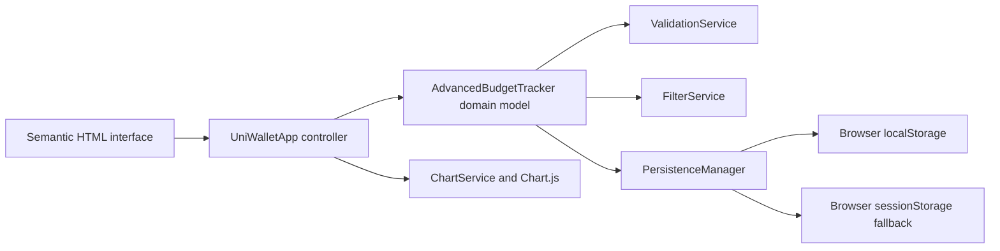

# UniWallet Pro

[](https://github.com/toksadekoya/UniWalletPro/actions/workflows/ci.yml)
[](https://toksadekoya.github.io/UniWalletPro/)
[](LICENSE)

UniWallet Pro is a private, accessible budgeting dashboard built for students. It tracks a budget and expenses, explains spending patterns, and keeps all financial data inside the user's browser.

**[Open the live application](https://toksadekoya.github.io/UniWalletPro/)** · **[Watch the usage demo](https://www.youtube.com/watch?v=pOLDaxP8DQA)**

[](https://www.youtube.com/watch?v=pOLDaxP8DQA)

## Why this project

Student budgets are often managed in disconnected notes or spreadsheets. UniWallet Pro provides one focused dashboard for setting a daily, weekly, or monthly budget, recording expenses, finding transactions, and seeing where money is going without creating an account or sending financial data to a server.

## Features

- Create daily, weekly, or monthly budgets
- Add, edit, delete, search, and filter expenses
- View remaining balance, category totals, and seven-day spending trends
- Receive plain-language budget and spending insights
- Export and restore a validated JSON backup
- Persist data locally, with session storage as a fallback
- Navigate the complete interface with a keyboard
- Use responsive layouts across mobile, tablet, and desktop screens

## Architecture



The deployed interface and automated tests use the same modular application code. User-provided descriptions are rendered through `textContent`, and imported backups are validated before replacing existing state.

## Technology

| Area | Tools |
| --- | --- |
| Interface | Semantic HTML, modern CSS, JavaScript modules |
| Visualisation | Chart.js |
| Build | Vite |
| Unit and integration tests | Vitest, JSDOM, V8 coverage |
| Browser and accessibility tests | Playwright, axe-core |
| Delivery | GitHub Actions, GitHub Pages |

## Local development

Requirements:

- Node.js 22 or 24
- npm

```bash
git clone https://github.com/toksadekoya/UniWalletPro.git
cd UniWalletPro
npm ci
npm run dev
```

The development server prints the local URL in the terminal.

## Quality checks

```bash
npm test          # unit/integration tests with coverage
npm run build     # production bundle
npm run test:e2e  # real Chromium user flows and accessibility scan
npm run check     # all of the above
```

CI runs the same tests and build for every pull request and every push to `main`. A successful push to `main` deploys the tested production bundle to GitHub Pages.

## Accessibility

The application includes associated form labels, visible filter labels, a skip link, semantic landmarks, keyboard-operable chart tabs, live status messages, accessible chart summaries, high-contrast category labels, visible focus indicators, and reduced-motion support. Playwright runs an axe-core scan against a populated dashboard.

Automated checks cannot replace manual assistive-technology testing. Screen-reader testing remains part of the roadmap.

## Security and privacy

- No account, analytics SDK, or backend service is used.
- Budget data and expenses remain in browser storage.
- Descriptions are inserted as text rather than HTML.
- Imported backups are limited to 1 MB and validated field by field.
- Runtime scripts and styles are bundled locally under a restrictive Content Security Policy.

This is an educational budgeting tool, not financial advice or a replacement for bank records. See [SECURITY.md](SECURITY.md) for reporting guidance.

## Known limitations

- Data does not automatically synchronise between devices.
- Clearing browser data removes the budget unless a backup has been exported.
- The dashboard supports GBP only.
- Charts describe recorded expenses; they do not connect to bank accounts.

## Author

Built by [Adetokunbo “Toks” Adekoya](https://github.com/toksadekoya).
